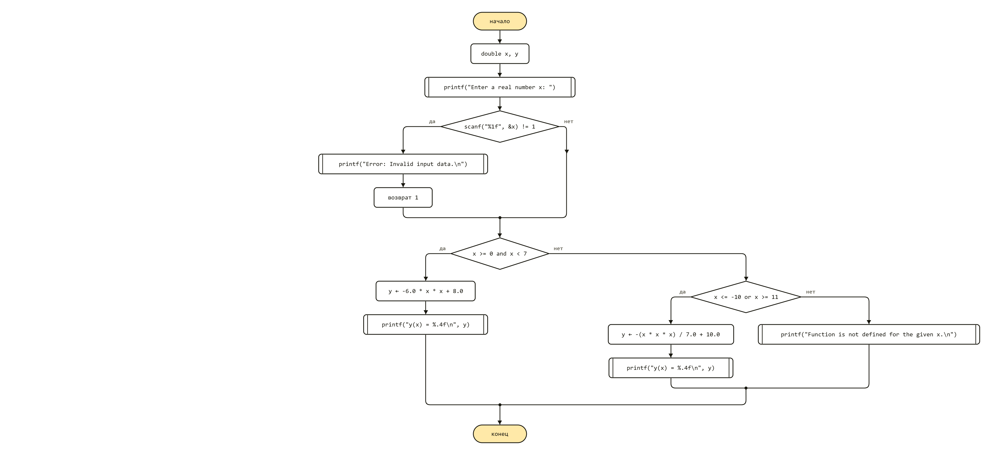
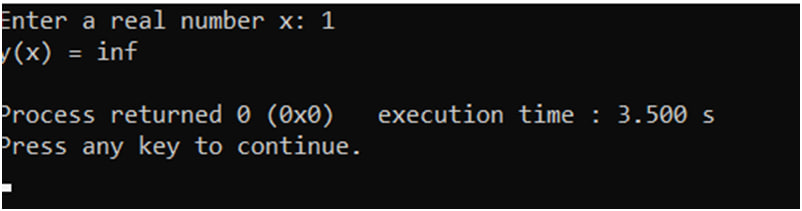
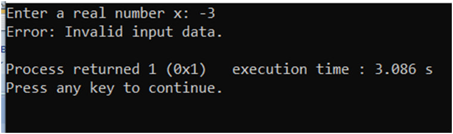
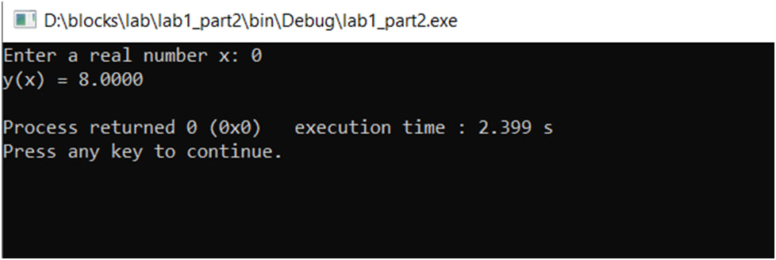
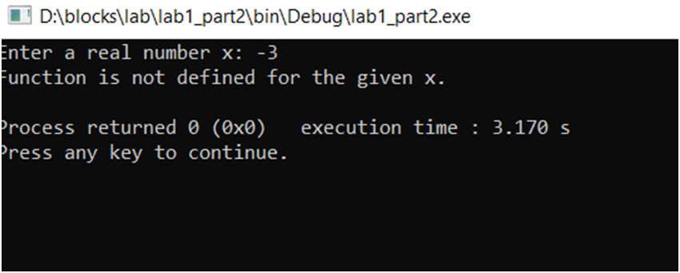

# Лабораторні роботи з дисципліни "Структури даних та алгоритми
Виконав Осіпчук Ілля Вікторович ІО-63
Репозиторій:https://github.com/osipchukilliaio63/Labs
## Лабораторна робота №1 
Тема: Розгалужені алгоритми 
1. У папці Lab1/ створено файл part1.c із синтаксисом першої частини завдання.
2. У папці Lab1/ створено файл lab1_part2.c із кодом другої частини завдання.
3. Блок-схема до частини 1:

4. Блок-схема до частини 2:
.png)
5. Виконання програм
6. 
7. 
8. 
9. 
10. 
