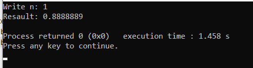
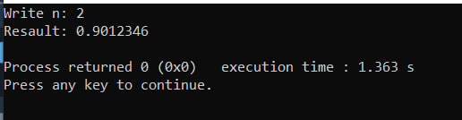
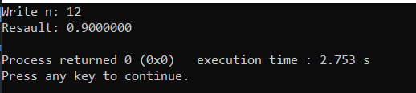
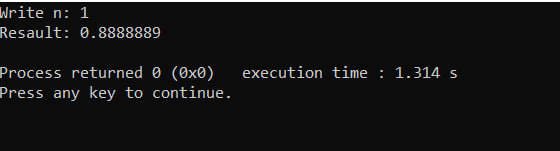
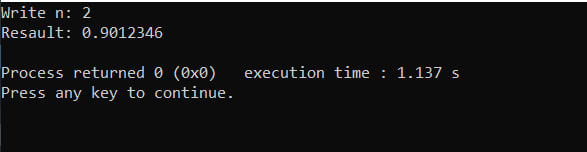
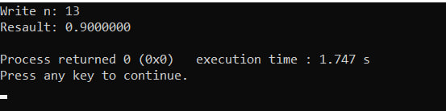
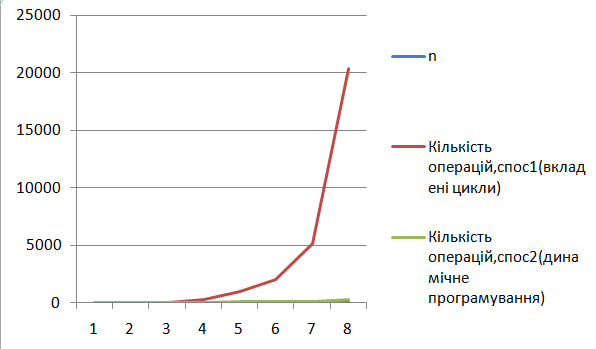

# Лабораторні роботи з дисципліни "Структури даних та алгоритми
Виконав Осіпчук Ілля Вікторович ІО-63
Репозиторій:https://github.com/osipchukilliaio63/Labs
## Лабораторна робота №1 
Тема: Розгалужені алгоритми 
1. У папці Lab1/ створено файл part1.c із синтаксисом першої частини завдання.
2. У папці Lab1/ створено файл lab1_part2.c із кодом другої частини завдання.
3. Блок-схема до частини 1:

4. Блок-схема до частини 2:
.png)
5. Виконання програм
6. 
7. 
8. 
9. 
### Висновки
Під час виконання лабораторної роботи було практично освоєно застосування розгалужених алгоритмів мовою С для обчислення значень кусково-заданих математичних функцій. Було реалізовано перевірку вхідних даних на коректність за допомогою функції 'scanf', а також використано складні логічні умови ('&&' та '||') в операторах 'if' та 'else if' для точного визначення проміжків існування функції. Окрім цього, було успішно застосовано прапорець стану ('is_defined') для оптимізації виведення результату розрахунків або повідомлення про те, що функція не визначена для заданого аргументу.

## Лабораторна робота №2
Тема: Алгоритми з вкладеними циклами та метод динамічного програмування
Варіант: №19
### 1. Постановка задачі
Задане натуральне число $n$. Обчислити значення заданої за варіантом формули (ряду), що наближено обчислює значення функції у заданій точці $x = 1/3$.
$$S = \frac{1}{1+x^2} = \sum_{i=0}^{n} (-1)^i \cdot x^{2i}$$
### 2. Текст програм
[Код першої програми (Вкладені цикли)](./Lab2/lab2.part1.c)
[Код другої програми (Динамічне програмування)](./Lab2/lab2.part2.c)
### 3. Результати тестування та порівняльний аналіз
#### Таблиця кількості операцій:

#### Результати 

#### Графік 

### 4. Результати перевірки правильності обчислень на калькуляторі
#### 1) Розрахунок для $n = 2$:
* $i = 0$: $(-1)^0 \cdot (1/3)^0 = 1$
* $i = 1$: $(-1)^1 \cdot (1/3)^2 = -1/9 \approx -0.1111111$
* $i = 2$: $(-1)^2 \cdot (1/3)^4 = 1/81 \approx 0.0123457$
* **Сума $S_2$** $= 1 - 0.1111111 + 0.0123457 = \mathbf{0.9012346}$

*Результат у консолі програм при $n = 2$: `0.9012346`. Обчислення повністю збігаються.*

#### 2) Розрахунок для $n = 3$:
* Беремо готову суму для n=2 та додаємо наступний доданок для $i = 3$:
* $i = 3$: $(-1)^3 \cdot (1/3)^6 = -1/729 \approx -0.0013717$
* **Сума $S_3$** $= 0.9012346 - 0.0013717 = \mathbf{0.8998629}$

*Результат у консолі програм при n = 3: `0.8998628`. Значення збігаються з точністю до шостого знака після коми (мінімальна розбіжність у сьомому знаці зумовлена округленням періодичних дробів під час ручного підрахунку).*

### 4. Висновки
Під час виконання лабораторної роботи було досліджено два підходи до обчислення математичних рядів мовою C. 
Перший спосіб із використанням вкладених циклів продемонстрував квадратичну складність $O(n^2)$, оскільки операція степеня обчислюється «з нуля» на кожній ітерації. 
Другий спосіб на основі методу динамічного програмування показав значно вищу ефективність із лінійною складністю $O(n)$, оскільки кожен наступний доданок накопичується на базі попереднього. Це дозволило скоротити кількість операцій при $n=100$ у 64 рази, зберігши абсолютно однакову точність типу `double`.

