# Лабораторні роботи з дисципліни "Структури даних та алгоритми
Виконав Осіпчук Ілля Вікторович ІО-63
Репозиторій:https://github.com/osipchukilliaio63/Labs
## Лабораторна робота №1 
Тема: Розгалужені алгоритми 
1. У папці Lab1/ створено файл part1.c із синтаксисом першої частини завдання.
2. У папці Lab1/ створено файл lab1_part2.c із кодом другої частини завдання.
3. Блок-схема до частини 1:
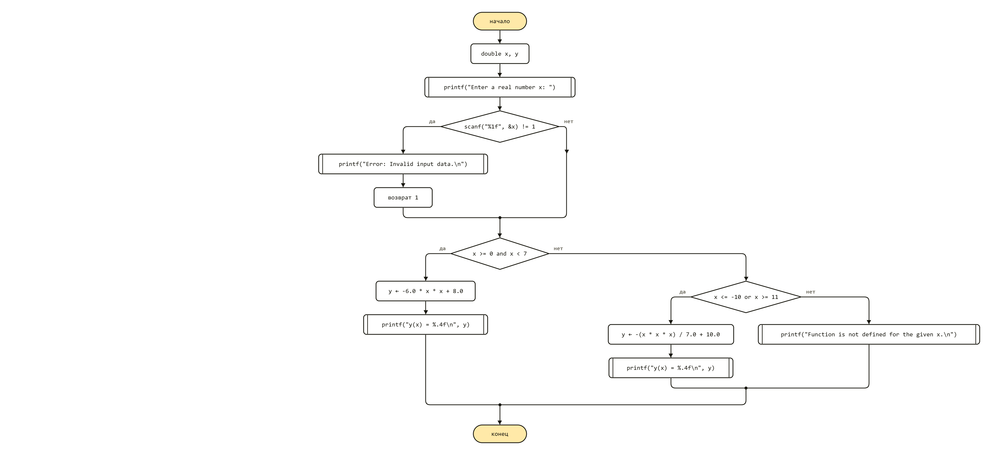
4. Блок-схема до частини 2:
.png)
5. Виконання програм
6. 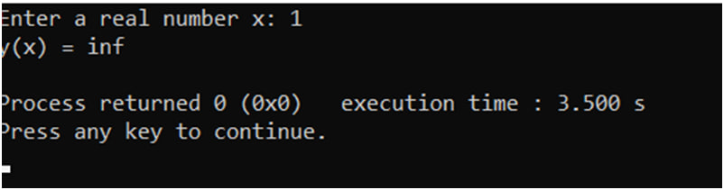
7. 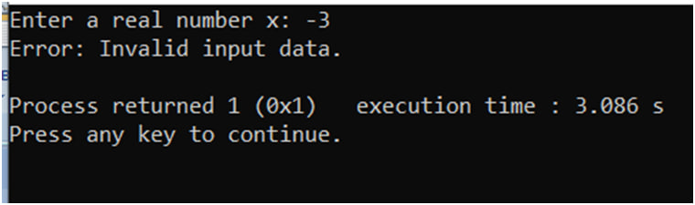
8. 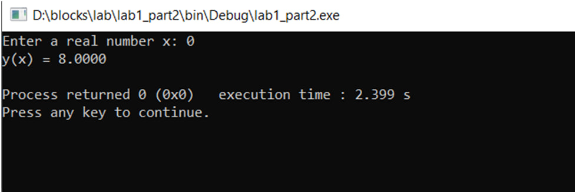
9. 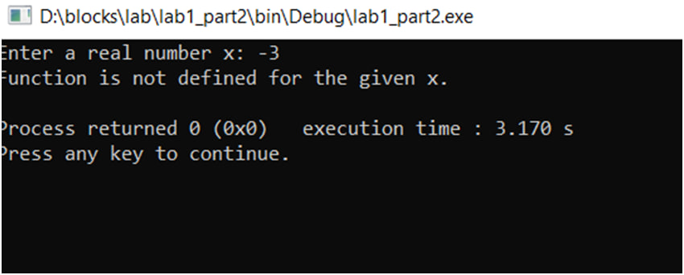
### Висновки
Під час виконання лабораторної роботи було практично освоєно застосування розгалужених алгоритмів мовою С для обчислення значень кусково-заданих математичних функцій. Було реалізовано перевірку вхідних даних на коректність за допомогою функції 'scanf', а також використано складні логічні умови ('&&' та '||') в операторах 'if' та 'else if' для точного визначення проміжків існування функції. Окрім цього, було успішно застосовано прапорець стану ('is_defined') для оптимізації виведення результату розрахунків або повідомлення про те, що функція не визначена для заданого аргументу.


## Лабораторна робота №2
Тема: Алгоритми з вкладеними циклами та метод динамічного програмування
Варіант: №19
### 1. Постановка задачі
Задане натуральне число $n$. Обчислити значення заданої за варіантом формули (ряду), що наближено обчислює значення функції у заданій точці $x = 1/3$.
$$S = \frac{1}{1+x^2} = \sum_{i=0}^{n} (-1)^i \cdot x^{2i}$$
### 2. Текст програм
[Код першої програми (Вкладені цикли)](./Lab2/lab2.part1.c)
[Код другої програми (Динамічне програмування)](./Lab2/lab2.part2.c)
### 3. Результати тестування та порівняльний аналіз
#### Таблиця кількості операцій:

#### Результати 
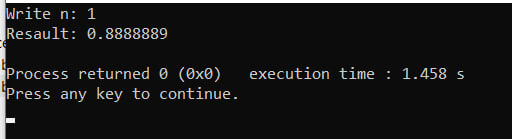
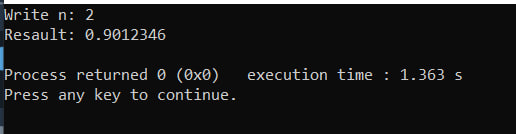
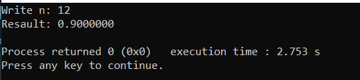

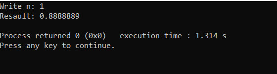
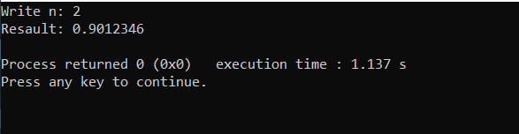
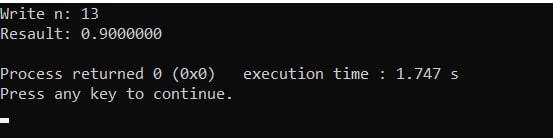

#### Графік 
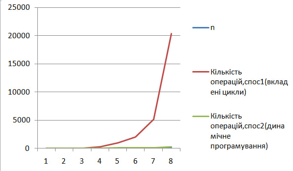

### 4. Результати перевірки правильності обчислень на калькуляторі
#### 1) Розрахунок для $n = 2$:
* $i = 0$: $(-1)^0 \cdot (1/3)^0 = 1$
* $i = 1$: $(-1)^1 \cdot (1/3)^2 = -1/9 \approx -0.1111111$
* $i = 2$: $(-1)^2 \cdot (1/3)^4 = 1/81 \approx 0.0123457$
* **Сума $S_2$** $= 1 - 0.1111111 + 0.0123457 = \mathbf{0.9012346}$

*Результат у консолі програм при $n = 2$: `0.9012346`. Обчислення повністю збігаються.*

#### 2) Розрахунок для $n = 3$:
* Беремо готову суму для n=2 та додаємо наступний доданок для $i = 3$:
* $i = 3$: $(-1)^3 \cdot (1/3)^6 = -1/729 \approx -0.0013717$
* **Сума $S_3$** $= 0.9012346 - 0.0013717 = \mathbf{0.8998629}$

*Результат у консолі програм при n = 3: `0.8998628`. Значення збігаються з точністю до шостого знака після коми (мінімальна розбіжність у сьомому знаці зумовлена округленням періодичних дробів під час ручного підрахунку).*

### 4. Висновки
Під час виконання лабораторної роботи було досліджено два підходи до обчислення математичних рядів мовою C. 
Перший спосіб із використанням вкладених циклів продемонстрував квадратичну складність $O(n^2)$, оскільки операція степеня обчислюється «з нуля» на кожній ітерації. 
Другий спосіб на основі методу динамічного програмування показав значно вищу ефективність із лінійною складністю $O(n)$, оскільки кожен наступний доданок накопичується на базі попереднього. Це дозволило скоротити кількість операцій при $n=100$ у 64 рази, зберігши абсолютно однакову точність типу `double`.

## Лабораторна робота №3
Тема:Стеки та черги
Завдання: Чергою змоделювати планування процесів методом кругового обслуговування (round robin) з фіксованим квантом часу: кожен процес має відому загальну тривалість виконання; на кожному кроці процес з початку черги виконується один квант, після чого (якщо не завершився) повертається в кінець черги. Вивести порядок завершення процесів +додатково визначити для кожного процесу його час очікування (сумарний час у черзі) та час обороту (від надходження до завершення).додатково визначити для кожного процесу його час очікування (сумарний час у черзі) та час обороту (від надходження до завершення).

```c
#include <stdio.h>
#include <stdbool.h>
#include <string.h>

#define MAX_PROCESSES 100
#define MAX_QUEUE 100

typedef struct {
    char name[10];       
    int burst_time;      
    int remaining_time;  
    int quantum;         
    int waiting_time;    
} Process;

typedef struct {
    int data[MAX_QUEUE];
    int head;
    int tail;
    int count;
} Queue;

void init_queue(Queue *q) {
    q->head = 0;
    q->tail = 0;
    q->count = 0;
}

bool is_empty(Queue *q) {
    return q->count == 0;
}

bool is_full(Queue *q) {
    return q->count == MAX_QUEUE;
}

void enqueue(Queue *q, int val) {
    if (is_full(q)) {
        printf("[ERROR] Queue overflow! Cannot enqueue.\n");
        return;
    }
    q->data[q->tail] = val;
    q->tail = (q->tail + 1) % MAX_QUEUE;
    q->count++;
}

int dequeue(Queue *q) {
    if (is_empty(q)) {
        printf("[ERROR] Queue underflow! Cannot dequeue from an empty array.\n");
        return -1;
    }
    int val = q->data[q->head];
    q->head = (q->head + 1) % MAX_QUEUE;
    q->count--;
    return val;
}
```

### Результат роботи (Circular Array)


---

## 2. Код програми 2: Динамічний зв'язаний список (Linked List)

```c
#include <stdio.h>
#include <stdlib.h>
#include <stdbool.h>

typedef struct {
    char name[10];
    int burst_time;
    int remaining_time;
    int quantum;
    int completion_time;
} Process;

typedef struct Node {
    int process_index;
    struct Node* next;
} Node;

typedef struct {
    Node* head;
    Node* tail;
} Queue;

void init_queue(Queue *q) {
    q->head = NULL;
    q->tail = NULL;
}

bool is_empty(Queue *q) {
    return q->head == NULL;
}

void enqueue(Queue *q, int process_index) {
    Node* new_node = (Node*)malloc(sizeof(Node));
    if (!new_node) return;
    new_node->process_index = process_index;
    new_node->next = NULL;

    if (is_empty(q)) {
        q->head = new_node;
        q->tail = new_node;
    } else {
        q->tail->next = new_node;
        q->tail = new_node;
    }
}

int dequeue(Queue *q) {
    if (is_empty(q)) return -1;

    Node* temp = q->head;
    int res = temp->process_index;

    q->head = q->head->next;
    if (q->head == NULL) {
        q->tail = NULL;
    }

    free(temp);
    return res;
}
```

### Результат роботи (Linked List)


---

## 3. Аналіз результатів та Висновок

* **Тестування:** Обидві структури даних були протестовані на однакових вхідних даних (процеси P1, P2, P3 з індивідуальними квантами). Результати симуляції повністю збігаються (Середній час очікування = **10.33**), що доводить правильність логіки алгоритму.
* **Порівняння:** Реалізація на кільцевому масиві є швидшою у виконанні, але обмежена фіксованим розміром статичного буфера. Динамічний список дозволяє гнучко використовувати оперативну пам'ять без обмежень на кількість процесів, проте потребує ручного очищення пам'яті за допомогою `free()`.


